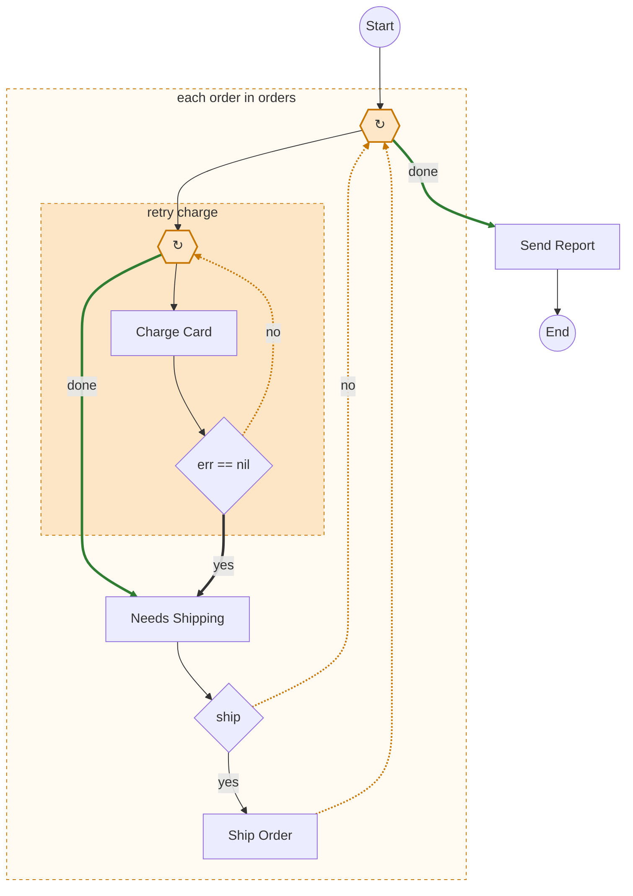

# timetell

timetell reads a Temporal workflow written in Go and draws it as a flowchart. It works from the source alone and never runs your code, so it needs no worker and no Temporal server.

The output is [Mermaid](https://mermaid.js.org), a text format for diagrams that GitHub renders inside Markdown. This is what timetell makes of a workflow with a retry loop inside a per-order loop:



It came from this function. Dotted orange edges go round a loop again. Thick edges leave a loop: green when it finishes, dark when a `break` cuts it short.

```go
func LoopNested(ctx workflow.Context, orders []string) error {
	ctx = workflow.WithActivityOptions(ctx, workflow.ActivityOptions{StartToCloseTimeout: time.Minute})
	for _, order := range orders {
		var err error
		//timetell:decision retry charge
		for attempt := 1; attempt <= 3; attempt++ {
			err = workflow.ExecuteActivity(ctx, ChargeCard, order).Get(ctx, nil)
			if err == nil {
				break
			}
		}
		if err != nil {
			return err
		}
		var ship bool
		if err := workflow.ExecuteActivity(ctx, NeedsShipping, order).Get(ctx, &ship); err != nil {
			return err
		}
		if ship {
			if err := workflow.ExecuteActivity(ctx, ShipOrder, order).Get(ctx, nil); err != nil {
				return err
			}
		}
	}
	return workflow.ExecuteActivity(ctx, SendReport).Get(ctx, nil)
}
```

The `if err != nil { return err }` checks are left out of the diagram on purpose. They would bury the parts that matter.

## Quick start

You need Go 1.26 or later.

```sh
go install github.com/leighstillard/timetell/cmd/timetell@latest
cd your-temporal-service
timetell graph ./...
```

Run it from inside the Go module that holds your workflows. The module must build, because timetell type-checks it the way `go vet` does.

## Why it exists

A Temporal workflow is ordinary Go, which makes it pleasant to write and hard to review. What runs when, what waits on whom, and which loops can spin forever are spread across `if`s, `for`s, helper calls, and error checks. A reviewer has to rebuild the flow in their head from the diff. More of that code is now written by coding agents, and the reviewer still has to do the rebuilding.

A picture is faster. Python has [`temporalio-graphs`](https://github.com/LucaDeLeo/temporalio-graphs), and timetell started as a port of it. Go's type checker, the part of the compiler that knows what every name refers to, made it possible to go further:

- Loops are drawn as loops. The Python tool flattens them into a straight line.
- A branch you didn't mark still shows up. An `if` that runs different activities on each arm becomes a decision labelled with its condition, so conditional work never looks unconditional.
- Paths are counted from the shape of the graph. A decision nested inside one arm of another adds a path and doesn't double the total, and the count is worked out without listing every path. The Python tool reports 2ⁿ paths for n decisions however they are arranged.
- Names resolve through Go's types, so import aliases, method values such as `a.Charge`, and `const` names all lead to the real function or string.

## What it draws

| In your code | In the diagram |
|---|---|
| `ExecuteActivity` | a box, at the call site |
| `if` with different activities on each arm | a decision diamond with `yes` and `no` edges, labelled with the condition |
| `switch` with different activities per case | a decision diamond with one edge per case |
| `//timetell:decision Label` above an `if`, a `for`, or a timed wait | your label in place of the condition source |
| `if err != nil { return err }` | nothing |
| an error arm that does work, such as a saga compensation | an `error` edge to that work |
| `for`, `for … range`, `for {}`, nested loops, `break`, `continue` | a dashed loop box with dotted back edges and a highlighted exit. A loop whose body does no Temporal work is not drawn |
| `GetSignalChannel(…).Receive`, `workflow.Await` | a wait node, labelled with the signal when timetell can tell which one |
| `AwaitWithTimeout` followed directly by `if ok` or `if !ok` on its result | a wait node with `Signaled` and `Timeout` edges. Any other test of the result, such as `if ok && ready`, is an ordinary decision after the wait |
| `workflow.Sleep`, `workflow.NewTimer` | a timer node, showing the duration when it is a constant |
| `return workflow.NewContinueAsNewError(…)` | an edge to End labelled `continue-as-new` |
| the same activity called twice | two nodes (`SendEmail`, `SendEmail_2`), so a repeat never looks like a loop |

timetell finds your workflows by itself. It starts from the functions you pass to `worker.RegisterWorkflow`. If the packages register nothing, it takes every exported function whose first parameter is a `workflow.Context`.

## What it doesn't draw yet

Read this before you trust a diagram. Some constructs are skipped today, and two of them are skipped without a warning.

| In your code | What happens today |
|---|---|
| activities called from a helper function | not drawn, no warning |
| `ExecuteChildWorkflow` | not drawn, no warning |
| signals sent to another workflow | not drawn, no warning |
| `workflow.Selector`, `workflow.Go`, and any other closure that makes Temporal calls | not drawn, warning |
| `defer`, native `go`, and native `select` with Temporal calls | not drawn, warning |
| `goto` | the path ends there, warning |
| a Temporal call on the right of `&&` or `\|\|` | drawn as if it always runs, warning |
| `GetVersion` | drawn as an ordinary `switch` on the version variable |

The warnings appear in the validation report of `-OutputFormat full`, each with a `file:line`. All of these are on the [roadmap](#roadmap).

## Usage

```sh
timetell graph                              # every workflow under ./...
timetell graph ./workflows/payments         # one package
timetell graph -workflow MoneyTransfer      # one workflow by name
timetell graph -Direction LR -o flow.mmd    # left-to-right, written to a file
timetell graph -OutputFormat paths          # the path list only
timetell graph -OutputFormat full           # graph, paths and validation report
```

Several workflows print one after another, sorted by name, each under a `%% Name` comment.

| Flag | Default | Meaning |
|---|---|---|
| `-workflow` | all | graph only the root workflow with this name |
| `-o` | stdout | write to a file |
| `-Direction` | `TD` | `TD` (top-down) or `LR` (left-to-right) |
| `-OutputFormat` | `mermaid` | `mermaid`, `paths` or `full` |
| `-StartLabel`, `-EndLabel` | `Start`, `End` | labels of the end points |
| `-DecisionTrueLabel`, `-DecisionFalseLabel` | `yes`, `no` | labels of a decision's two edges |
| `-SignalSuccessLabel`, `-SignalTimeoutLabel` | `Signaled`, `Timeout` | labels of a timed wait's two edges |
| `-SplitNamesByWords` | `true` | show `ChargeCard` as "Charge Card" |
| `-MaxDecisionPoints` | `10` | warn above this many decisions in one workflow |
| `-MaxPaths` | `1024` | list at most this many paths (the count is always exact) |

### Paths and the validation report

`-OutputFormat paths` lists every distinct route from Start to End, with each loop taken zero or one times. It makes a handy checklist of test cases:

```
--- Execution Paths (4 total) ---
Decision Points: 2

Path 1: Start → WithdrawFunds → CurrencyConvert → NotifyATO → DepositFunds → End
Path 2: Start → WithdrawFunds → CurrencyConvert → TakeNonResidentTax → DepositFunds → End
Path 3: Start → WithdrawFunds → NotifyATO → DepositFunds → End
Path 4: Start → WithdrawFunds → TakeNonResidentTax → DepositFunds → End
```

`-OutputFormat full` prints the graph, the paths, and a validation report. The report warns about each activity name and each received signal name that is built at runtime, each construct the table above marks with a warning, and each workflow with more decisions than `MaxDecisionPoints`. A clean report is not proof that everything was drawn: the constructs marked "no warning" stay silent, and a `workflow.Await` whose signal can't be worked out is labelled `wait` without a warning.

### Naming decisions

By default a decision is labelled with its condition source, such as `err == nil`. To give it a business name, put a directive comment on the line above:

```go
//timetell:decision Need To Convert
if needConversion {
	…
}
```

The same directive names a loop or a timed wait.

### From the library

The CLI is a thin wrapper over `timetell.Graph`:

```go
cfg := timetell.DefaultConfig()
cfg.Direction = "LR"
out, err := timetell.Graph(".", cfg, "./...")
```

```sh
go get github.com/leighstillard/timetell
```

timetell depends on the Go standard library and `golang.org/x/tools` only. It doesn't import the Temporal SDK (software development kit).

### Getting an image

GitHub, GitLab, Notion, Obsidian, and many other tools render Mermaid in Markdown, so you can paste the output into a fenced `mermaid` block. For PNG or SVG, use [mermaid-cli](https://github.com/mermaid-js/mermaid-cli):

```sh
timetell graph -workflow MoneyTransfer -o flow.mmd && mmdc -i flow.mmd -o flow.svg
```

Pick one workflow with `-workflow` for this. Output that holds several workflows is several diagrams in a row, which mermaid-cli can't read as one file.

## Roadmap

These are planned and not built yet:

- child workflows (as a reference, an inline expansion, or a subgraph)
- signals sent between workflows, matched by name
- `workflow.Selector` fan-out
- `GetVersion` branches
- `workflow.Go` coroutines and query/update handlers
- activities called from helper functions
- `timetell lint`: activities invoked but not registered (and the reverse), missing activity timeouts, `GetVersion` without a default branch, unpaired signals
- `timetell diff A B`: one graph showing what changed between two revisions
- JSON output and a `go vet` analyzer

## FAQ

### Does timetell run my workflow?

No. It reads and type-checks the source with `go/packages`, then walks the syntax tree. Nothing is executed.

### Which Temporal SDK versions work?

It is built and tested against `go.temporal.io/sdk` v1.50.0. SDK calls are matched by package path and function name, so older versions should work wherever those functions exist. The oldest supported version hasn't been established yet.

### My workflow checks `err` after every activity. Will the diagram be full of diamonds?

No. An `if err != nil` arm that only returns is left out. An error arm that does real work, such as undoing earlier steps in a saga, is drawn as an `error` edge.

### Why does an `if` I didn't mark show up as a decision?

Because its arms run different activities, and leaving it out would show conditional work as if it always runs. Branches whose arms do the same Temporal work are not drawn. Add `//timetell:decision` to give the diamond a readable name.

### Why is an activity missing from my diagram?

Most likely it is called from a helper function or a closure, which timetell doesn't follow yet. See [What it doesn't draw yet](#what-it-doesnt-draw-yet).

### Why is a call shown as `?`?

The activity name is built at runtime, so it can't be worked out without running the code. `-OutputFormat full` lists each case with its `file:line`.

### Does it check for non-determinism?

No. Temporal's own [`workflowcheck`](https://github.com/temporalio/sdk-go/tree/master/contrib/tools/workflowcheck) already flags `time.Now`, `rand`, map iteration, and goroutines in workflow code. Run it alongside timetell.

### Can I use it in CI?

Yes. It is a single binary that exits non-zero on errors, and a common use is generating diagrams into a PR or a docs folder. Failing a build on findings arrives with `timetell lint`.

### I get "no workflows found".

The packages loaded fine, but none of them registers a workflow or exports a function taking a `workflow.Context`. Check that the package pattern points at your workflow code, and that you're running from inside the module that holds it.

### How does it compare to `temporalio-graphs`?

It keeps that tool's node shapes, labels, config names, and output formats, so output from the two can be compared. It differs in the ways listed under [Why it exists](#why-it-exists). Design notes are in [docs/analysis.md](docs/analysis.md) and [docs/control-flow.md](docs/control-flow.md).

## Contributing

Each fixture in [`testdata/`](testdata) is a small workflow plus the Mermaid it should produce. Support for a new construct usually starts with a new fixture. Run `go test ./...`. After an intended change, `go test . ./internal/render -update` regenerates the expected files (only those two packages know the `-update` flag).

## Licence

MIT. See [LICENSE](LICENSE).
